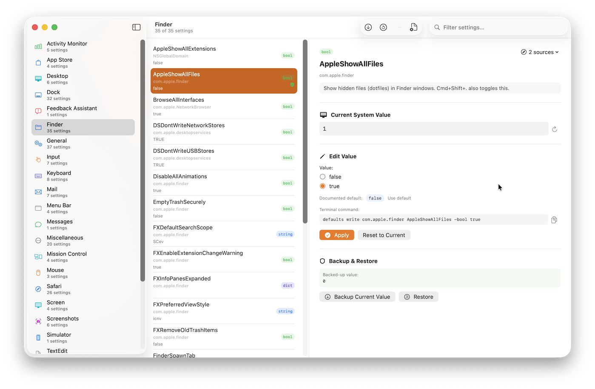

# defaultsManager

defaultsManager is a native macOS app for browsing, editing, backing up, and restoring hidden macOS `defaults` settings — the same preferences power users normally manage via the `defaults` command-line tool. It ships with a curated, documented database of 234 settings across 25 categories and 51 domains, so you can find and change a setting without hunting through blog posts and gists. Every change shows the exact `defaults write` command before you apply it, and every setting can be backed up and restored individually or as a full system snapshot.

> ⚠️ **Use with caution.** Changing system defaults can affect the stability and behavior of macOS. Always create a backup before making changes.

---

## Screenshots



---

## Features

- **Browse 234 curated settings** across 25 categories and 51 macOS domains
- **3-column layout** — category → setting → detail
- **Live system values** — reads the actual current value from your system
- **Edit values** with context-aware controls (segmented toggle, radio buttons, text field)
- **CLI command preview** — shows the exact `defaults write …` command for the current value with a one-click copy button
- **Documented defaults** — each entry includes description, type, and the Apple-documented default value
- **Global search** — search across all 234 settings simultaneously (key, domain, value, category, description)
- **Favorites** — star any setting to save it; export all favorites as a ready-to-run shell script
- **Session change history** — every setting changed during the current session is listed in one place, with before/after values
- **Backup & Restore**
  - Per-entry backup/restore in the detail view
  - Full-system backup via `defaults export` (one plist per domain)
  - Full-system restore via `defaults import`
- **Restart prompts** — after applying a change, the app tells you what needs to restart (Dock, Finder, SystemUIServer) and lets you do it with one click
- **Sandbox detection** — settings that belong to containerised apps (Safari, Mail, TextEdit…) show a clear warning with a direct link to grant Full Disk Access if needed
- **System Settings deep links** — jump directly to the related preference pane
- **Source links** — each entry links to the community source where it was documented
- **Editable database** — the settings database is a plain JSON file stored in `~/Library/Application Support/defaultsManager/`. Add your own entries or modify existing ones; the app merges updates from new app versions without overwriting your customisations.

---

## Requirements

| | |
|---|---|
| **macOS** | 14.0 (Sonoma) or later |
| **Architecture** | Apple Silicon only |

---

## Installation

### Build from source

1. Clone the repository:
   ```bash
   git clone https://github.com/dirkclemens/defaultsManager.git
   cd defaultsManager
   ```
2. Open `defaultsManager.xcodeproj` in Xcode.
3. Select the **defaultsManager** scheme and your Mac as the run destination.
4. Press **⌘R** to build and run.

> **Note:** The app runs without a sandbox (`ENABLE_APP_SANDBOX = NO`). This is required to send signals to system processes (Finder, Dock, SystemUIServer), run `defaults export/import`, and access preferences of containerised apps when Full Disk Access is granted. This is intentional for a developer power tool.

### Prebuilt DMG

A ready-to-run build is available as `defaultsManager.dmg` (ad-hoc signed, Apple Silicon only). Since it isn't notarized by Apple, macOS blocks it on first launch. Remove the quarantine flag before opening:

```bash
xattr -dr com.apple.quarantine /Applications/defaultsManager.app
```

Alternatively, right-click the app in Finder and choose "Open".

---

## Usage

### Browsing settings

Select a **category** in the left sidebar (sorted A–Z), then a **setting** in the middle column to see its full detail — description, current system value, documented default, and sources.

The sidebar also provides two smart views at the top:

| Sidebar item | Description |
|---|---|
| ⭐ **Favorites** | All settings you have starred |
| 🔄 **Changed** | Every setting modified during the current session |

### Searching

Type in the search field (middle column) to search **all 234 settings** at once. Results are sorted A–Z and show a category pill so you always know where each setting lives. Clear the field to return to the selected category view.

### Editing a value

1. Open a setting in the detail view.
2. Use the editor (segmented toggle, radio buttons, or text field) to set the new value.
3. The **Terminal command** field below the editor updates live, showing the exact `defaults write` command. Use the **📋** button to copy it to the clipboard.
4. Click **Apply** (or **⌘↩**) to write the value immediately.
5. If a restart is required (e.g. Dock, Finder), a banner appears with a **Restart Now** button.

### Favorites

Click the **⭐** button in any setting's detail view to mark it as a favorite. Favorites:

- Persist across app restarts.
- Appear in the **Favorites** sidebar view with category badges.
- Can be exported as a shell script for quick re-application on a new machine:

  | Export option | Where |
  |---|---|
  | Copy as Shell Script | Favorites toolbar → Export → *Copy as Shell Script* |
  | Save as Shell Script | Favorites toolbar → Export → *Save as Shell Script…* |

The exported script looks like:

```bash
#!/bin/bash
# macOS Defaults — Favorites
# Generated by defaultsManager on 2026-04-30T10:43:00Z
# Run with:  bash <filename>

# ── Dock ──────────────────────────
defaults write com.apple.dock autohide -bool true
defaults write com.apple.dock tilesize -integer 48

# ── Finder ──────────────────────────
defaults write com.apple.finder AppleShowAllFiles -bool true
```

### Session change history

Every time you click **Apply**, the entry is recorded with its before and after value. Open **Changed** in the sidebar to review all changes made this session. The badge on the sidebar row shows the running count. The history is cleared when you quit the app.

### Containerised app settings (Safari, Mail, TextEdit…)

Some settings belong to sandboxed apps whose preferences are stored in `~/Library/Containers/`. These require **Full Disk Access** for defaultsManager to read or write them. If access is missing, the detail view shows an orange banner with an **Open Privacy & Security Settings** button.

Steps to enable:
1. Click **Open Privacy & Security Settings** in the banner.
2. Add **defaultsManager** to the Full Disk Access list.
3. Relaunch defaultsManager.

### Backup & Restore

| Action | Where |
|---|---|
| Back up a single setting | Detail view → *Backup Current Value* |
| Restore a single setting | Detail view → *Restore* |
| Back up all settings | Toolbar → *Backup All* |
| Restore all settings | Toolbar → *Restore All* |

**Backup All** exports every domain as a `.plist` file to:
```
~/Library/Application Support/defaultsManager/domain_backup/
```

**Restore All** re-imports all exported plists via `defaults import`.

### Editing the settings database

Click **Edit Parameters JSON** in the toolbar to reveal `macos-defaults.json` in Finder. The file is a JSON array of objects:

```json
{
  "domain": "com.apple.dock",
  "key": "autohide",
  "value": "false",
  "type": "bool",
  "category": "Dock",
  "description": "Automatically hide and show the Dock.",
  "all_values": ["false", "true"],
  "sources": ["https://macos-defaults.com/dock/autohide.html"],
  "settings_url": "x-apple.systempreferences:com.apple.preference.dock",
  "restart_action": "Dock"
}
```

| Field | Required | Description |
|---|---|---|
| `domain` | ✅ | Preference domain (e.g. `com.apple.dock`, `NSGlobalDomain`) |
| `key` | ✅ | Defaults key name |
| `value` | ✅ | Documented default value |
| `type` | ✅ | `bool`, `integer`, `float`, `string`, `array`, `dict`, `data` |
| `category` | ✅ | Sidebar category name |
| `description` | | Human-readable description |
| `all_values` | | Array of allowed values — rendered as radio buttons |
| `sources` | | Array of reference URLs |
| `settings_url` | | `x-apple.systempreferences:` deep link |
| `restart_action` | | `Dock`, `Finder`, `SystemUIServer`, `logout`, or `none` |

When the app updates, new entries are merged in automatically. Your existing entries and edits are never overwritten.

---

## Architecture

```
defaultsManager/
├── Models.swift                # DefaultEntry, DefaultValueType, BackupEntry, SidebarItem
├── DefaultsStore.swift         # Loads & merges JSON; exposes entries, categories, search
├── SessionStore.swift          # In-memory change history for the current session
├── FavoritesStore.swift        # Persistent favorites (UserDefaults); shell script export
├── BackupManager.swift         # Per-entry and full-domain backup/restore
├── ApplyManager.swift          # Wraps `defaults read/write`; detects container/FDA issues
├── RestartActionResolver.swift # Maps entries → restart actions; performs kill(pid, SIGTERM)
├── SettingsURLResolver.swift   # Maps domains → System Settings deep links
├── ContentView.swift           # Root NavigationSplitView + toolbar + progress modal
├── DomainListView.swift        # Left column — Favorites, Changed, and category list
├── KeyListView.swift           # Middle column — searchable entry list with indicators
├── DetailView.swift            # Right column — value, editor, CLI preview, backup, restart
├── ChangedView.swift           # Session change history with before/after diff
└── FavoritesView.swift         # Favorites list with export toolbar
```

### Settings database

`macos-defaults.json` is bundled with the app and copied to Application Support on first launch. Sources:

| Source | Description |
|---|---|
| [macos-defaults.com](https://macos-defaults.com) | Community-maintained, well-documented defaults reference |
| [mathiasbynens/dotfiles](https://github.com/mathiasbynens/dotfiles/blob/main/.macos) | The canonical macOS dotfiles reference, widely used in the community |
| [FrancesCoronel/dotfiles](https://github.com/FrancesCoronel/dotfiles/blob/master/init/.osx) | Community dotfiles with additional macOS tweaks |
| [jessfraz/dotfiles](https://github.com/jessfraz/dotfiles/blob/master/bin/macos-defaults) | Developer-focused macOS defaults collection |
| [SixArm/macos-defaults](https://github.com/SixArm/macos-defaults/blob/main/macos-defaults) | Curated macOS defaults reference list |
| [ChristopherA/macOS defaults gist](https://gist.github.com/ChristopherA/98628f8cd00c94f11ee6035d53b0d3c6) | Annotated gist of macOS preference keys |

---

## Contributing

Pull requests are welcome. To add or correct entries in the settings database, edit `defaultsManager/macos-defaults.json` and open a PR.

Please verify any new `defaults` key against actual macOS behavior before submitting.

---

## License

This project is licensed under the [PolyForm Noncommercial License 1.0.0](https://polyformproject.org/licenses/noncommercial/1.0.0) — see [LICENSE](LICENSE) for details. Free for noncommercial use; commercial use requires a separate license from the author.
